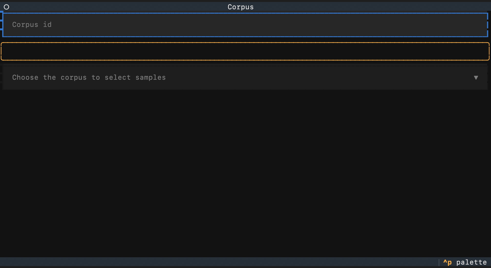
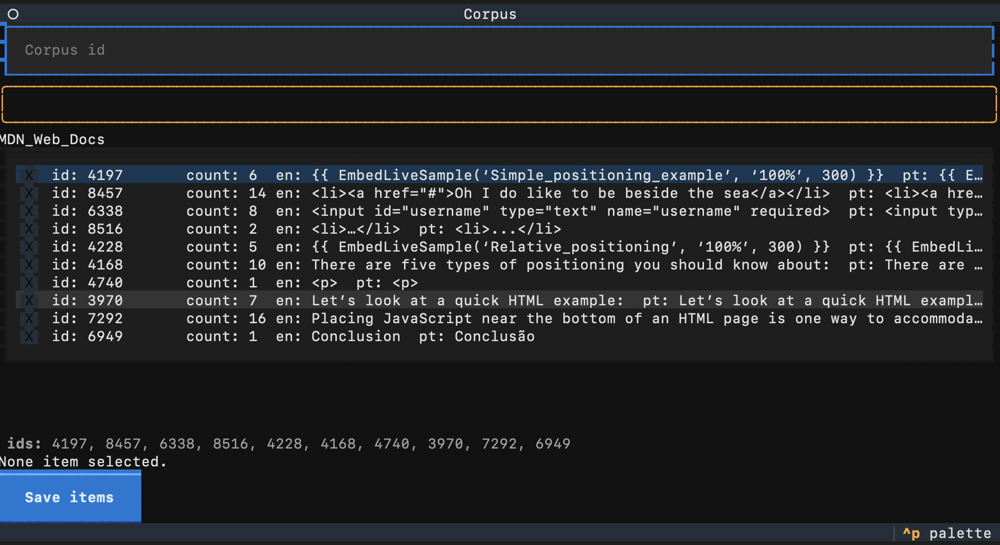

# Curadoria de Corpus Paralelo EN–PT

Ferramenta usada em um TCC para montar, de forma **manual e controlada**, um corpus paralelo (inglês → português) a partir de três fontes de texto:

| Corpus | Origem | Conteúdo |
| --- | --- | --- |
| **OpenSubtitles** | Legendas de filmes e séries | Linguagem falada, diálogos |
| **MDN Web Docs** | Documentação da web | Texto técnico em inglês |
| **PHP** | Manual do PHP | Texto técnico em inglês |

A ideia central é simples: o programa sorteia frases dos corpora, você escolhe quais são boas o suficiente para o estudo, e o sistema guarda essa escolha em um banco de dados. Assim, a mesma frase nunca é avaliada duas vezes e é possível saber exatamente quantas frases válidas existem em cada fonte — além de controlar o tamanho médio das frases, que é uma métrica importante da pesquisa.

---

## Como funciona (visão geral)






1. **Preparação dos dados** — os textos originais vêm em dois arquivos alinhados (um em inglês e um em português), com uma frase por linha. O script `separate.py` junta os dois em um único `.jsonl`, onde cada linha é um par `{"id", "en", "pt"}`.
2. **Sorteio e curadoria** — `batch.py` abre uma interface interativa no terminal. Ele sorteia 10 pares por rodada, já ignorando os que foram avaliados antes.
3. **Seleção** — você marca as frases que considera adequadas. O restante da rodada é registrado como descartado.
4. **Persistência** — as frases escolhidas vão para `out/<Corpus>_seed.jsonl` e todas as decisões ficam no banco `db/corpus.db`.
5. **Backup** — a cada salvamento, `gitBackup.py` faz commit e push das mudanças, garantindo o histórico da curadoria.

---

## Arquivos do projeto

| Arquivo | O que faz |
| --- | --- |
| `separate.py` | Junta os arquivos `.en` e `.pt_BR` linha a linha e gera um `.jsonl` com pares de tradução. |
| `convert.py` | Converte um `.json` (lista de objetos) em `.jsonl` (um objeto por linha). Útil para fontes que já vêm em JSON. |
| `batch.py` | Interface principal (biblioteca [Textual](https://textual.textualize.io/)). Sorteia frases, permite selecionar/descartar, mostra a média de palavras e salva as escolhas. |
| `common.py` | Funções auxiliares: leitura aleatória de uma linha do `.jsonl`, contagem de palavras com `prose_tokenizer` e verificação de existência de arquivo. |
| `db.py` | Camada de acesso ao SQLite: criação da tabela, inserção, consulta de média e verificação de duplicatas. |
| `gitBackup.py` | Executa `git add`, `git commit` e `git push` automaticamente após cada lote salvo. |
| `visualizer.py` | Gera um gráfico simples (matplotlib) com a quantidade de palavras por frase e a média do corpus. |

### Estrutura de pastas

```
.
├── <Corpus>.jsonl          # dados de entrada (um par EN/PT por linha)
├── db/corpus.db            # banco SQLite com toda a curadoria
├── out/<Corpus>_seed.jsonl # frases aprovadas, prontas para uso
├── backup/                 # cópia dos arquivos originais
├── batch.py                # aplicação principal
└── ...                     # demais scripts auxiliares
```

---

## Banco de dados

A tabela `files` guarda uma linha por frase avaliada:

| Coluna | Significado |
| --- | --- |
| `id` | Identificador da frase dentro do corpus |
| `corpus_name` | Nome do corpus (`OpenSubtitles`, `MDN_Web_Docs`, `PHP`) |
| `sentence_size` | Número de palavras da frase em inglês |
| `is_valid` | `TRUE` se a frase foi aprovada, `FALSE` se foi descartada |

A chave primária é composta por `(corpus_name, id)`, o que impede avaliar a mesma frase duas vezes.

---

